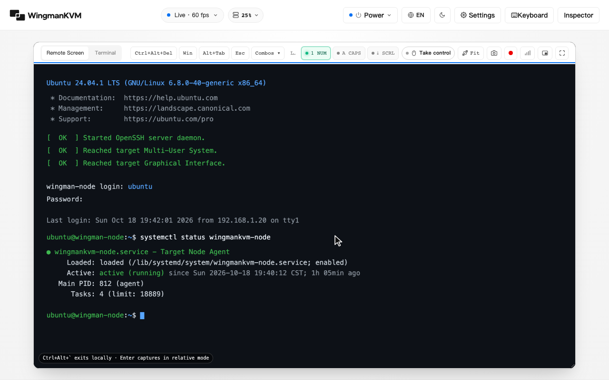
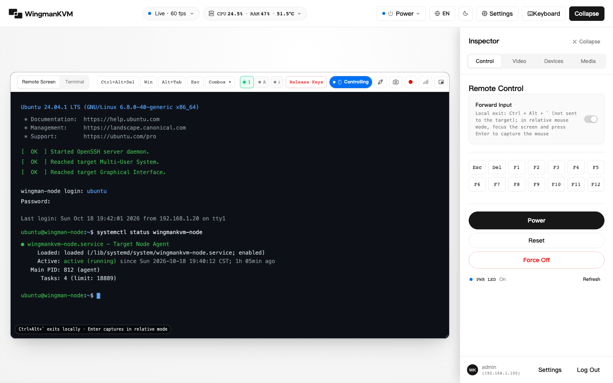

[简体中文](README.md) | English

# WingmanKVM



WingmanKVM is a web-based KVM that runs on an ARM development board. Connect the target machine's HDMI output to a capture card and its USB to the development board's OTG port, and you can view the screen and operate the keyboard and mouse (including during BIOS) from a browser, mount ISO images, and optionally control power through GPIO relays.

It deploys as a single binary and needs no separate database or frontend build tooling.



## Features

**Video**
- Automatic transport selection: WebRTC H.264 (with RK3399 hardware encoding) first, falling back to MJPEG when unavailable
- Optional HDMI audio: the capture card's sound is sent as Opus over WebRTC (off by default, pages start muted, not available in MJPEG mode)
- Fit-to-window / 1:1 pixels / fill display modes; pan by dragging in 1:1 mode
- Screenshots (PNG) and local screen recording (WebM)

**Keyboard and mouse**
- Emulated USB keyboard, relative mouse, and absolute pointer, usable in BIOS / UEFI
- Keyboard and mouse events use a persistent WebSocket connection and fall back to HTTP when it disconnects; the server releases all keys when the connection drops
- Paste as typing: types clipboard text from your machine into the target machine character by character, with US / UK / DE / FR / JP layouts
- Shortcut menu (Ctrl+Alt+Del, Ctrl+Alt+F1–F7, etc.) and custom combinations
- Virtual keyboard, keyboard LED synchronization, and phone touch gestures (tap, long-press for right click, two-finger scroll)

**Virtual media and power**
- Upload ISO / IMG files in the web UI and mount them to the target machine as a CD-ROM or USB drive
- Optional GPIO power control: short press, reset, forced power off (forced power off requires holding for 1 second to confirm)

**Accounts and operations**
- Administrator password + Passkey (Touch ID / Face ID / Windows Hello / security key) login
- Diagnostics panel: video and encoding status, keyboard/mouse write successes/failures, KVM host CPU / memory / temperature
- Built-in web terminal (restricted account); the session is preserved when switching to the video page
- UI available in Simplified Chinese, Traditional Chinese, and English, with light / dark themes

## Hardware requirements

| Component | Requirement |
|---|---|
| KVM host | Linux ARM development board (aarch64 or armv7) with a USB OTG port that supports Device mode (the kernel provides UDC and configfs). Verified on Firefly RK3399 |
| Capture card | UVC driver-free HDMI capture card that supports MJPG output |
| Power control (optional) | Relay module, with dry contacts wired in parallel to the target machine motherboard's power / reset pins |
| System | Debian 12 / Armbian bookworm or newer (release packages require glibc ≥ 2.34) |

```text
Target machine HDMI output  ──>  HDMI capture card  ──USB──>  KVM host USB Host port
Target machine USB port     <──  USB cable  ───────────────>  KVM host OTG port (usually Type-C)
Target machine power pins   <──  Relay dry contacts  ──────>  KVM host GPIO (optional)
Browser                     <──  LAN  ─────────────────────>  http://<KVM host IP>:8080
```

## Quick start

> Only the `v2.0.0-rc.1` pre-release exists for now. Until the stable release, append `--version v2.0.0-rc.1` to the command in step 1.

1. On the KVM host, run the installer (it detects the architecture, verifies the download and installs; `--install-deps` adds missing runtime packages):

   ```bash
   curl -fsSL https://raw.githubusercontent.com/XiNian-dada/WingmanKVM/main/scripts/get.sh | sudo bash -s -- --install-deps
   ```

2. In a browser on the same LAN, open the one-time setup link printed at the end. If you lose it, reprint it with `sudo wingmankvm-setup-url`.
3. Follow the wizard to set the administrator account and confirm the detected devices.

For pinning a version, manual downloads, a LAN name (`--mdns`) and troubleshooting, see the [deployment guide](docs/en/DEPLOYMENT.md).

## Security recommendations

WingmanKVM can directly operate the target machine; treat it as the physical console of a server:

- Do not expose port 8080 directly to the public internet. For remote access, use a VPN (such as WireGuard or Tailscale), or deploy behind an HTTPS reverse proxy and configure `server.public_origin` (see [session cookie policy](docs/SESSION_COOKIES.md) (Chinese)).
- The web terminal uses a restricted account without sudo by default; enable root maintenance explicitly only when needed, see [maintenance privilege mode](docs/MAINTENANCE_MODES.md) (Chinese).

## Documentation

- [Deployment guide](docs/en/DEPLOYMENT.md): dependencies, building from source, configuration, reverse proxy, troubleshooting
- [Firefly RK3399 deployment walkthrough](docs/en/RK3399_GUIDE.md)
- [Upgrade and recovery](docs/en/UPGRADE_RECOVERY.md)
- [Maintenance privilege mode](docs/MAINTENANCE_MODES.md) (Chinese) · [Session cookie policy](docs/SESSION_COOKIES.md) (Chinese) · [Upload limits](docs/UPLOAD_LIMITS.md) (Chinese) · [HID configuration migration](docs/HID_CONFIGURATION.md) (Chinese)
- [Testing](docs/en/TESTING.md)
- [Changelog](CHANGELOG.md) (Chinese)

## Development

```bash
cargo build
cargo test --locked
python3 scripts/verify_audit2_ui.py   # requires Playwright and a local Chrome
```

Frontend sources are in `web/` (HTML, CSS split by feature, and native ES modules in `web/js/app/` with no bundler) and are embedded into the binary at build time; the frontend is linted with ESLint (`npm ci && npx eslint`). For tests and CI, see the [testing guide](docs/en/TESTING.md).

## License

[MIT](LICENSE)
