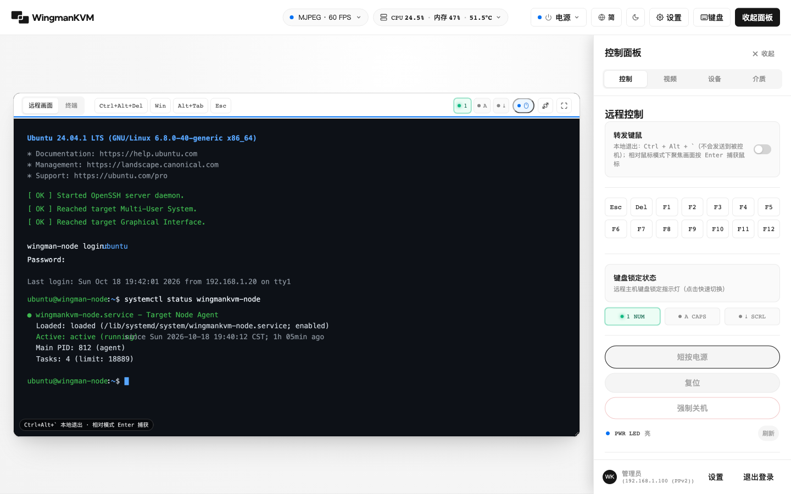
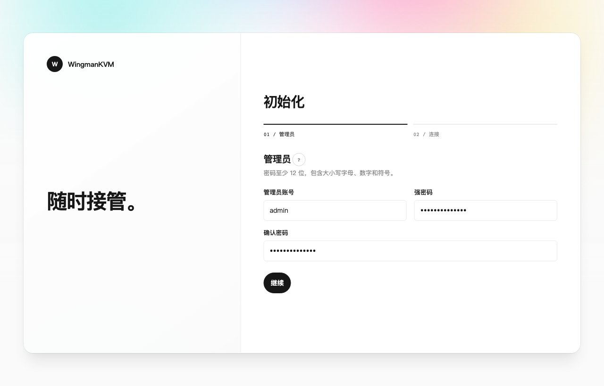
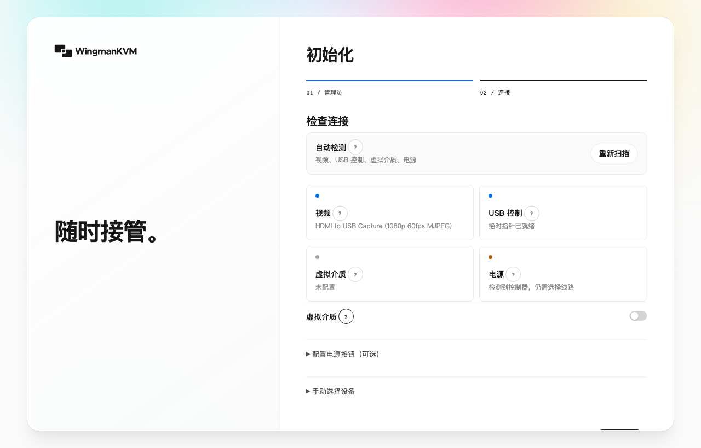
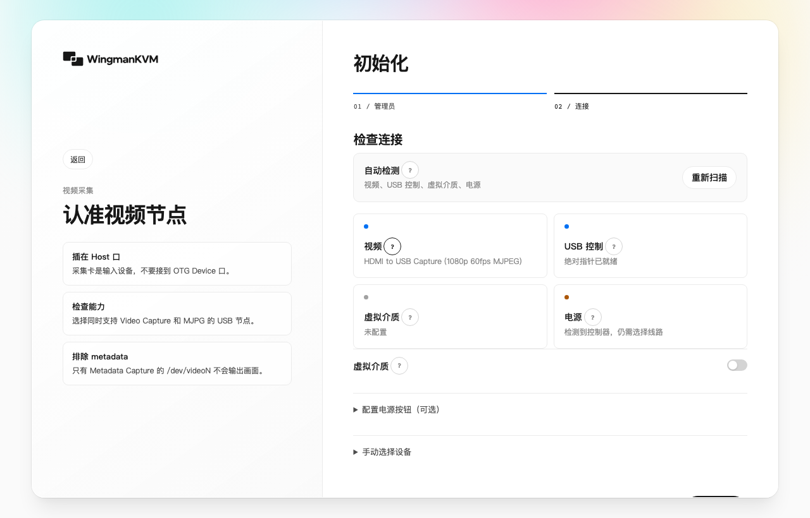
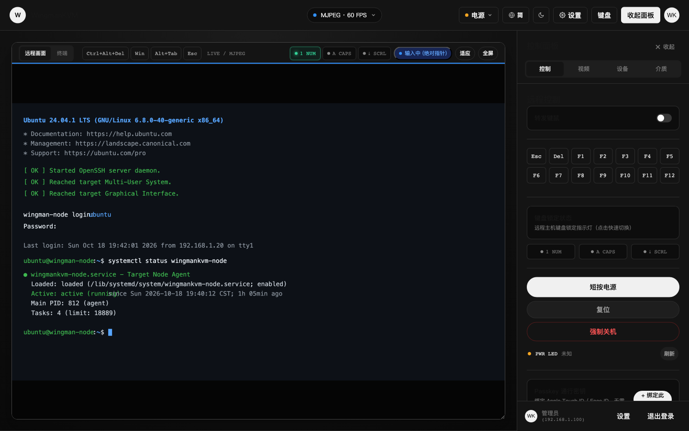
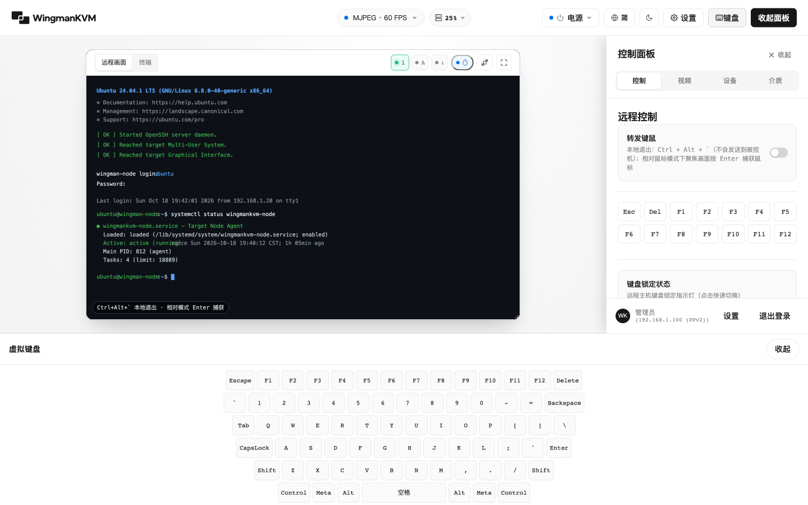
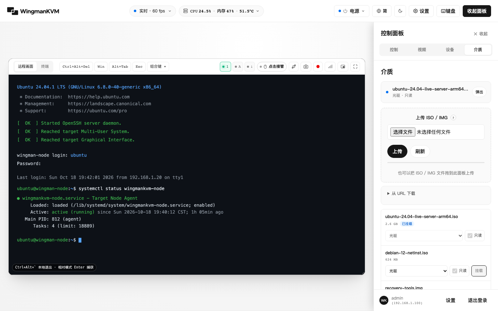
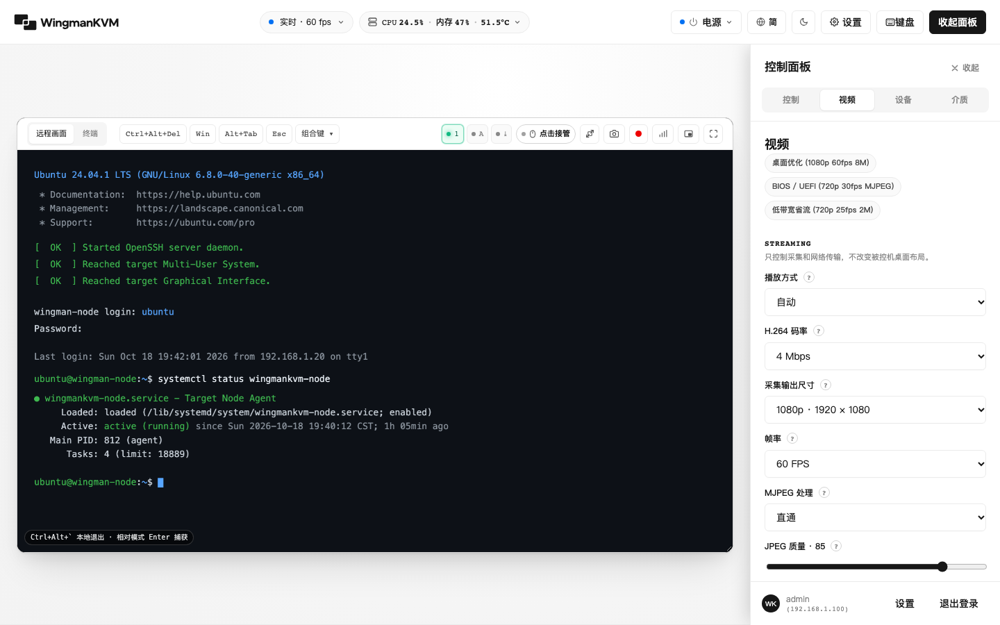

# WingmanKVM

轻量、现代的 Linux Web KVM：将 HDMI 采集卡、USB Gadget 与 GPIO 电源控制整合为一体，只需在浏览器中即可实现远程屏幕查看、BIOS 级键鼠操作、物理电源控制与 ISO/IMG 虚拟介质挂载。



---

## 硬件连接概览

```text
被控机 HDMI 输出  ──>  HDMI 采集卡  ──USB──>  KVM 主机 USB Host 口
被控机 USB Host   <──  USB OTG 线  ────────>  KVM 主机 Type-C / OTG 口
被控机 POWER SW   <──  继电器干接点 ────────>  KVM 主机 GPIO 针脚（可选）
浏览器终端        <──────  局域网网络  ──────>  http://<KVM主机IP>:8080
```

- **视频采集**：HDMI 采集卡插入 KVM 主机的 USB Host 接口。
- **键鼠与介质**：KVM 主机的 OTG/Device 接口（通常为 Type-C）连接被控机 USB 接口，模拟 USB 键盘、鼠标与虚拟 U 盘。
- **电源控制（可选）**：通过 GPIO 控制继电器模块，并联至被控机主板电源针脚。

---

## 极速开始（三步搞定）

### 1. 准备依赖并构建

在 KVM 主机（Debian / Ubuntu / Armbian）上执行：

```bash
sudo apt update
sudo apt install -y build-essential pkg-config clang libclang-dev linux-libc-dev libgpiod-tools v4l-utils

git clone https://github.com/XiNian-dada/WingmanKVM.git
cd WingmanKVM
cargo build --release --locked
```

### 2. 一键安装与启动

```bash
sudo ./deploy/install.sh --binary ./target/release/wingmankvm
```

安装脚本会自动配置 systemd 服务、USB Gadget 复合设备（键盘、相对鼠标、绝对指针、虚拟介质）、权限规则，并启动监听在 `8080` 端口。

### 3. 打开网页完成初始化

安装完成后终端会输出一次性初始化地址：

```text
http://<你的主机IP>:8080/#setup=...
```

在同一局域网的电脑或平板浏览器中打开该地址，完成两步向导：

1. **设置管理员账号与强密码**（密码同时同步给主机内置终端用户 `wingman`）；
2. **确认自动检测到的硬件设备**（采集卡、HID 键鼠、虚拟介质 LUN）。

完成即可直接进入控制台接管远端机器！

#### 监听地址配置

`server.listen_address` 接受不带方括号的 IPv4 或 IPv6 字面地址，`server.port` 范围为 1–65535；加载与保存使用相同校验。通过完整配置 PUT 修改监听地址或端口后，需要重启服务才会重新绑定；这类成功响应带有 `X-WingmanKVM-Restart-Required: true`。响应头表示本次提交更改了监听设置，不是当前进程监听状态的查询。

---

## 核心功能与界面一览

### 1. 极简首次配置与硬件自检

初始化向导自动扫描可用的 V4L2 采集卡与 USB Gadget 节点，无需手动翻查设备树或配置文件。

| 步骤一：创建管理员 | 步骤二：连接自检 | 硬件指引 |
| :---: | :---: | :---: |
| [](docs/images/setup-account.png) | [](docs/images/setup-detection.png) | [](docs/images/setup-guide.png) |

---

### 2. 沉浸式深浅色控制台

支持日间明亮模式与极客质感的深色模式（Dark Mode），提供常用快捷键（`Ctrl+Alt+Del`、`Win`、`Alt+Tab`、`Esc`）与键盘状态锁指示灯（NumLock、CapsLock、ScrollLock 双向同步）。

| 浅色模式 | 深色模式 |
| :---: | :---: |
| [](docs/images/console-desktop.png) | [](docs/images/console-dark.png) |

---

### 3. 虚拟软键盘与全键位支持

平板、手机或移动端无需外接键盘，点击控制台顶部的“键盘”即可展开标准全尺寸虚拟键盘，支持 8 字节 Boot HID 规范与全部功能键。



---

### 4. 虚拟介质挂载（ISO / IMG）

无需频繁插拔物理 U 盘。支持在网页中直接上传 ISO/IMG 镜像，一键挂载为只读系统安装光驱或读写存储设备，被控机可直接开机引导或读写数据。



---

### 5. 灵活画质调节与低延迟直通

默认采用超低延迟的 MJPEG 直通模式，局域网体验丝滑流畅；同时支持一键切换预设模式（桌面优化 1080p 60fps、BIOS / UEFI、低带宽省流）或按需启用 WebRTC H.264 编码。

视频设置中的尺寸与帧率只控制采集和网络传输；被控机的桌面分辨率需要在其操作系统中设置。当前版本不提供虚拟显示器或 EDID 写入功能。



---

## 硬件实战与专题指南

- **Firefly RK3399 部署实战**：查看 [Firefly RK3399 从零部署指南](docs/RK3399_GUIDE.md)，包含详细接口对应、系统配置与避坑速查。
- **采集尺寸与显示器分辨率**：查看 [MS2130 EDID 历史调研与旧配置兼容说明](docs/MS2130_EDID.md)。
- **高级自定义配置**：查看 [系统部署与进阶排障说明](docs/DEPLOYMENT.md)。

---

## 许可证

基于 [MIT 许可证](LICENSE) 开源。
