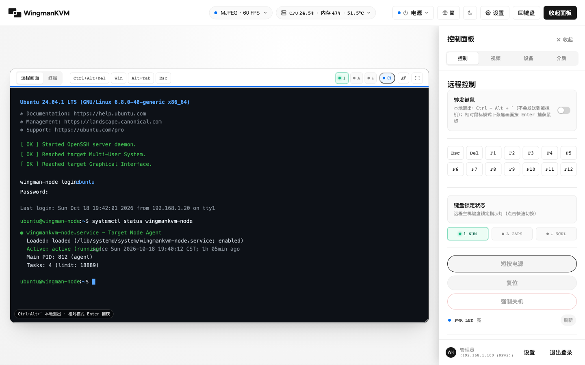
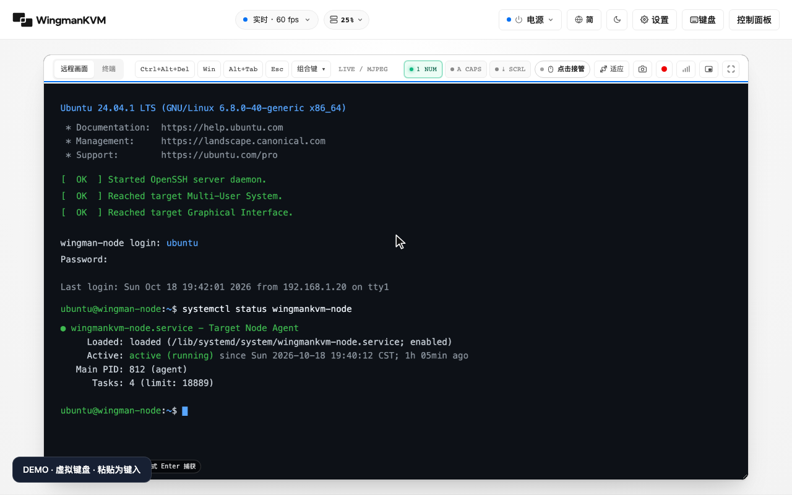
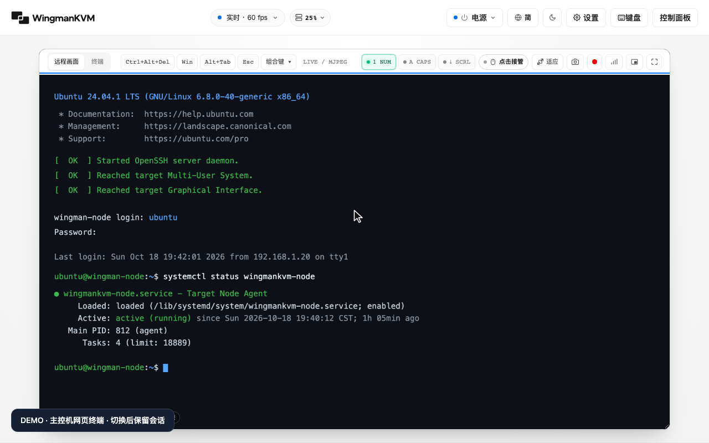
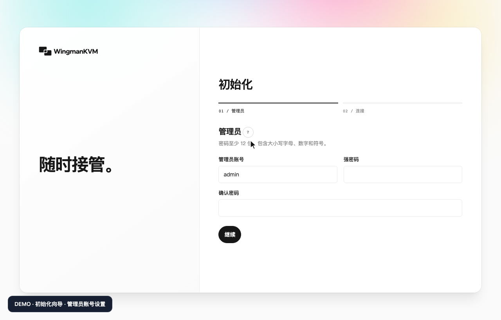

简体中文 | [English](README.en.md)

# WingmanKVM



WingmanKVM 是一个运行在 ARM 开发板上的网页 KVM。把被控机的 HDMI 输出接到采集卡、USB 接到开发板的 OTG 口，就可以在浏览器里远程看画面、操作键鼠（包括 BIOS 阶段）、挂载 ISO 镜像，并可选地通过 GPIO 继电器控制电源。

单个二进制部署，不需要额外的数据库或前端构建工具。

## 功能

**画面**
- 自动选择传输方式：WebRTC H.264 → Direct H.264（WebSocket + WebCodecs）→ MJPEG；两种 H.264 传输共用编码器，支持自适应码率（[使用说明](docs/DIRECT_H264.md)）
- JPEG 压缩支持可选黑白省流模式：在视频设置中选择“JPEG 压缩”后开启“黑白省流”，降低编码负载和带宽（默认关闭）
- JPEG 算法可热切换：屏幕优化、标准高速、兼容编码、整数向量优化、系数重压缩及保真省流；可单独选择优化编码表，说明见 [JPEG 配置](docs/JPEG_PROCESSING.md)
- 可选 HDMI 音频：采集卡声音以 Opus 随 WebRTC 传输（默认关闭，页面从静音开始，Direct H.264 和 MJPEG 模式不支持）
- 适应窗口 / 1:1 像素 / 填满三种显示方式，1:1 下可拖动平移
- 画面截图（PNG）与本地录屏（WebM）


**键盘与鼠标**
- 模拟 USB 键盘、相对鼠标和绝对指针，BIOS / UEFI 中可用
- 鼠标支持按住拖拽（拖动窗口、框选文本、拖动滚动条）和多键同按，绝对与相对指针模式均可
- 键鼠事件走 WebSocket 长连接，断开时自动回退 HTTP；连接中断时服务端自动释放所有按键和鼠标键
- 粘贴为键入：把本机剪贴板文字逐字输入被控机，支持 US / UK / DE / FR / JP 布局
- 组合键菜单（Ctrl+Alt+Del、Ctrl+Alt+F1–F7 等）与自定义组合
- 虚拟键盘、键盘指示灯同步、手机触屏手势（点按、长按右键、双指滚动）



**虚拟介质与电源**
- 网页上传 ISO / IMG，以光驱或 U 盘方式挂载给被控机
- 可选 GPIO 电源控制：短按、复位、强制关机（强制关机需按住 1 秒确认）

**账户与运维**
- 管理员密码 + Passkey（Touch ID / Face ID / Windows Hello / 安全密钥）登录
- 诊断面板：视频与编码状态、键鼠写入成功/失败、主控机 CPU / 内存 / 温度
- 内置网页终端（受限账户），切到视频页时会话保留
- 界面支持简体中文、繁體中文、English，浅色 / 深色主题



## 硬件要求

| 部件 | 要求 |
|---|---|
| KVM 主机 | Linux ARM 开发板（aarch64 或 armv7），需有支持 Device 模式的 USB OTG 口（内核提供 UDC 与 configfs）。已在 Firefly RK3399 上验证 |
| 采集卡 | UVC 免驱 HDMI 采集卡，需支持 MJPG 输出 |
| 电源控制（可选） | 继电器模块，干接点并联到被控机主板的电源 / 复位针脚 |
| 系统 | Debian 12 / Armbian bookworm 或更新（发布包要求 glibc ≥ 2.34） |

```text
被控机 HDMI 输出  ──>  HDMI 采集卡  ──USB──>  KVM 主机 USB Host 口
被控机 USB 口     <──  USB 线  ────────────>  KVM 主机 OTG 口（通常是 Type-C）
被控机电源针脚    <──  继电器干接点  ──────>  KVM 主机 GPIO（可选）
浏览器            <──  局域网  ────────────>  https://<KVM 主机 IP>:8080
```

## 快速开始

> 目前只有预发布版本 `v2.0.0-rc.1`，正式版发布前请在第 1 步的命令末尾加上 `--version v2.0.0-rc.1`。



1. 在 KVM 主机上运行安装命令（自动识别架构、校验并安装，`--install-deps` 会补齐缺少的运行依赖）：

   ```bash
   curl -fsSL https://raw.githubusercontent.com/XiNian-dada/WingmanKVM/main/scripts/get.sh | sudo bash -s -- --install-deps
   ```

2. 在同一局域网的浏览器中打开安装结束时打印的一次性初始化链接。链接丢失时，可运行 `sudo wingmankvm-setup-url` 重新打印。
3. 按向导设置管理员账号，并确认自动检测到的设备。

指定版本、手动下载发布包、局域网域名（`--mdns`）和排障见 [部署说明](docs/DEPLOYMENT.md)。

## 安全建议

WingmanKVM 能直接操作被控机，请把它当作服务器的物理控制台对待：

- 新安装默认启用内置 HTTPS 自签证书，可在“设置 → HTTPS 与证书”导入 CA 证书；8080 或公网映射端口均可使用，无需 443。旧配置保留 HTTP，迁移、证书信任与续期说明见 [HTTPS 与证书](docs/HTTPS.md)。远程访问也可使用 WireGuard/Tailscale 等 VPN。
- 网页终端默认使用无 sudo 权限的受限账户；需要 root 维护时再显式开启，见 [维护权限模式](docs/MAINTENANCE_MODES.md)。

## 文档

- [部署说明](docs/DEPLOYMENT.md)：依赖、源码构建、配置、反向代理、排障
- [Firefly RK3399 部署实战](docs/RK3399_GUIDE.md)
- [升级与恢复](docs/UPGRADE_RECOVERY.md)
- [维护权限模式](docs/MAINTENANCE_MODES.md) · [会话 Cookie 策略](docs/SESSION_COOKIES.md) · [上传限制](docs/UPLOAD_LIMITS.md) · [HID 配置迁移](docs/HID_CONFIGURATION.md)
- [测试说明](docs/TESTING.md)
- [真机测试清单](docs/HARDWARE_TEST_CHECKLIST.md)
- [变更日志](CHANGELOG.md)

## 开发

```bash
cargo build
cargo test --locked
python3 scripts/verify_audit2_ui.py   # 需要 Playwright 与本机 Chrome
```

前端源码在 `web/`（HTML、按功能拆分的 CSS，以及 `web/js/app/` 下的原生 ES 模块，无需打包），编译时嵌入二进制；前端用 ESLint 检查（`npm ci && npx eslint`）。测试与 CI 详见 [测试说明](docs/TESTING.md)。

## 许可证

[MIT](LICENSE)
