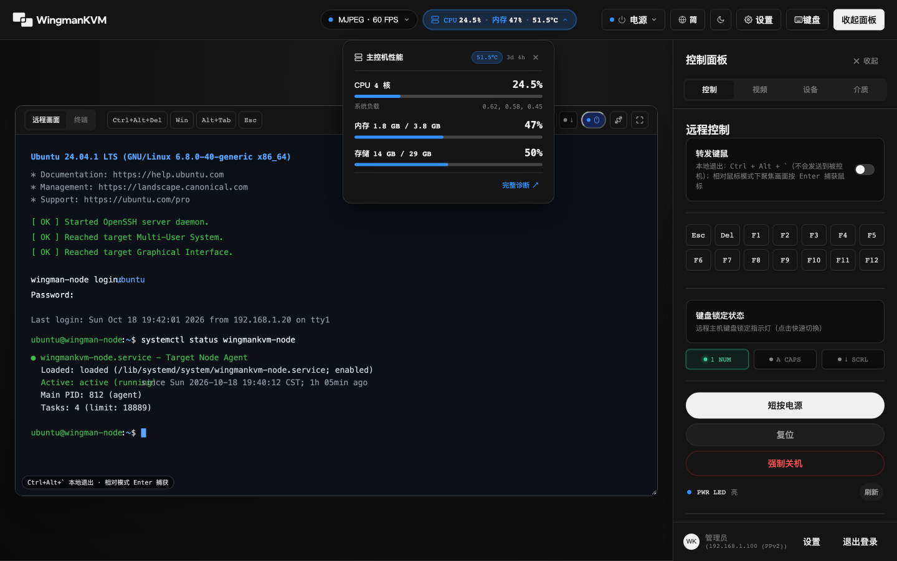
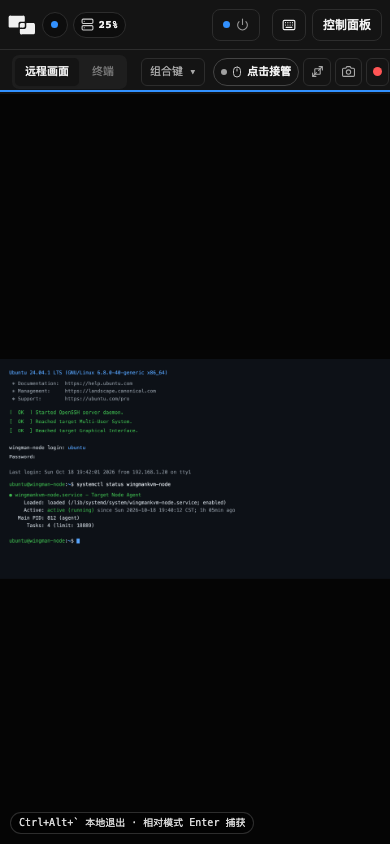

# WingmanKVM

轻量、现代的 Linux Web KVM：将 HDMI 采集卡、USB Gadget 与 GPIO 电源控制整合为一体，只需在浏览器中即可实现远程屏幕查看、BIOS 级键鼠操作、物理电源控制与 ISO/IMG 虚拟介质挂载。内置主控机性能监控（CPU/内存/磁盘/温度）、WebAuthn Passkey（Touch ID / Face ID）免密登录、1:1 原生像素画布平移与多语言国际化支持。


---

## 硬件连接概览

```text
被控机 HDMI 输出  ──>  HDMI 采集卡  ──USB──>  KVM 主机 USB Host 口
被控机 USB Host   <──  USB OTG 线  ────────>  KVM 主机 Type-C / OTG 口
被控机 POWER SW   <──  继电器干接点 ────────>  KVM 主机 GPIO 针脚（可选）
浏览器终端        <──────  局域网网络  ──────>  http://<KVM主机IP>:8080
```

- **视频采集**：HDMI 采集卡插入 KVM 主机的 USB Host 接口。
- **键鼠与介质**：KVM 主机的 OTG/Device 接口（通常为 Type-C）连接被控机 USB 接口，模拟 USB 键盘、鼠标与虚拟 U 盘。
- **电源控制（可选）**：通过 GPIO 控制继电器模块，并联至被控机主板电源针脚。

---

## 极速开始

### 使用发布包安装（推荐，无需 Rust 工具链）

1. 从 [Releases](https://github.com/XiNian-dada/WingmanKVM/releases) 下载与主机架构匹配的发布包：
   - ARM64（`aarch64`）：`wingmankvm-<版本>-aarch64-unknown-linux-gnu.tar.gz`
   - 32 位 ARM（`armv7` / `armhf`）：`wingmankvm-<版本>-armv7-unknown-linux-gnueabihf.tar.gz`

   同时下载同一 Release 中的 `SHA256SUMS`。
2. 将两个文件放在同一目录，校验后解压：

   ```bash
   sha256sum -c --ignore-missing SHA256SUMS
   mkdir -p wingmankvm-release
   tar -xzf wingmankvm-<版本>-<target>.tar.gz -C wingmankvm-release
   ```

   `--ignore-missing` 允许只下载当前架构的发布包。校验失败时不要继续安装。
3. 使用 `--release` 安装：

   ```bash
   cd wingmankvm-release
   sudo ./deploy/install.sh --release ../wingmankvm-<版本>-<target>.tar.gz
   ```

   安装器会在同一目录存在 `SHA256SUMS` 时再次校验，然后解包并复用 `--binary` 的安装、健康检查与事务回滚流程。

下面的第 1–3 步是从源码构建并安装的方式；需要自行编译或调试时继续。

### 1. 准备依赖并构建

在 KVM 主机（Debian / Ubuntu / Armbian）上执行：

```bash
sudo apt update
sudo apt install -y build-essential pkg-config clang libclang-dev linux-libc-dev libgpiod-tools v4l-utils python3

git clone https://github.com/XiNian-dada/WingmanKVM.git
cd WingmanKVM
cargo build --release --locked
```

> **依赖版本**：GPIO 电源控制要求 **libgpiod >= 2.x**（即 `gpioset` 2.x 命令语法）；安装器的健康检查与配置解析需要 `python3`。Debian bookworm 自带的 `libgpiod-tools` 为 1.x，启用电源控制前请从 bookworm-backports 或更新的发行版安装。完整依赖列表见 [DEPLOYMENT.md](docs/DEPLOYMENT.md)。

### 2. 一键安装与启动

```bash
sudo ./deploy/install.sh --binary ./target/release/wingmankvm
```

安装脚本会自动配置 systemd 服务、USB Gadget 复合设备（键盘、相对鼠标、绝对指针、虚拟介质）、权限规则，并启动监听在 `8080` 端口。

新装默认使用**受限网页终端**，`wingman` 不拥有 sudo 权限。需要主机 root 维护时，由主机管理员显式传入 `--maintenance-mode privileged`；旧版已有 root 授权的升级必须明确选择模式，详见[维护权限模式](docs/MAINTENANCE_MODES.md)。升级会保留整组托管文件的回滚快照，并检查 `/healthz`，详见[升级与恢复](docs/UPGRADE_RECOVERY.md)。

### 3. 打开网页完成初始化

安装完成后终端会输出一次性初始化地址：

```text
http://<你的主机IP>:8080/#setup=...
```

在同一局域网的电脑或平板浏览器中打开该地址，完成两步向导：

1. **设置管理员账号与强密码**（密码同时同步给主机内置终端用户 `wingman`）；
2. **确认自动检测到的硬件设备**（采集卡、HID 键鼠、虚拟介质 LUN）。

完成即可直接进入控制台接管远端机器！

#### 终端密码同步与降级说明

初始化或迁移旧版账号时，WingmanKVM 会尝试把管理员密码同步给内置终端用户 `wingman`。helper 的输入与等待期限为 5 秒，超时后最多再等待 2 秒回收进程。密码只通过标准输入传递，不会以明文写入 `auth.json` 或日志。

升级时须同时更新部署 helper：它使用 GNU coreutils 的 `/usr/bin/timeout`，在提权侧对 `chpasswd` 设置 3 秒期限，并在额外 1 秒后强制终止，避免依赖服务用户终止 root 进程。

- 同步成功时，`auth.json` 仅记录 `system_password_synced: true`，网页终端可用。
- 同步失败或超时时，初始化/KVM 登录仍会完成，画面、键鼠、电源与虚拟介质不受影响；但网页终端会保持不可用，并显示通用原因，终端 WebSocket 返回 `503`。首次设置不会因此失败，登录也不会被误报为完全就绪。
- 修复后使用同一正确密码**退出并重新登录**即可重试；成功后标记为已同步，后续登录直接跳过 helper。Passkey 登录不会在标记为 false 时伪造终端就绪状态。
- 并发登录只允许一个迁移尝试运行；其他登录立即以终端降级状态完成，不会排队等待。

#### 监听地址配置

`server.listen_address` 接受不带方括号的 IPv4 或 IPv6 字面地址，`server.port` 范围为 1–65535；加载与保存使用相同校验。通过完整配置 PUT 修改监听地址或端口后，需要重启服务才会重新绑定；这类成功响应带有 `X-WingmanKVM-Restart-Required: true`。响应头表示本次提交更改了监听设置，不是当前进程监听状态的查询。

HID 的 `write_timeout_ms` 和 `retry_interval_ms` 已弃用：旧配置文件兼容加载并提示，HTTP 配置更新会明确拒绝这两个字段。实际仍使用每份报告 500 ms 的固定期限和就绪等待，详见 [HID 配置迁移](docs/HID_CONFIGURATION.md)。

---

## 核心功能与界面一览

### 1. 沉浸式深浅色控制台与无跳变抽屉

支持日间明亮模式与极客质感的深色模式（Dark Mode）。右侧控制面板采用覆盖式抽屉（Drawer Overlay）设计，**无论展开还是收起，中央视频画面始终保持原始居中纵横比，绝不挤压变形或画面跳变**。

- **顶栏状态与控制**：集成 WingmanKVM 动态品牌图标、实时间隔采样、连接与设备诊断、快捷电源菜单（短按/复位/长按5秒）、多语言切换（简/繁/英）、深浅色切换、偏好设置与软键盘。
- **键盘物理锁定灯同步**：实时双向同步被控机 NumLock、CapsLock、ScrollLock 硬件指示灯，支持鼠标点击直接切换。
- **视频健康状态与快捷键**：收到有效视频帧显示 `LIVE`；超过 5 秒无有效帧标记为“已停止更新”；提供常用快捷键（`Ctrl+Alt+Del`、`Win`、`Alt+Tab`、`Esc`）。
- **本地退出快捷键**：开启键鼠转发后，按 `Ctrl + Alt + 反引号`（Ctrl+Alt+Backquote）立即在本地退出转发并释放所有按键与鼠标锁定，不干扰被控机；相对鼠标模式下聚焦画面按 `Enter` 快速捕获。

| 浅色模式 | 深色模式 |
| :---: | :---: |
| [](docs/images/console-desktop.png) | [](docs/images/console-dark.png) |

---

### 2. 实时主控机性能监控与类 NAS 浮动面板

无需额外登录 SSH 终端即可实时了解跑 WingmanKVM 的主控机负载与硬件状态。

- **顶栏常驻状态胶囊**：顶栏正中实时展示核心指标（如 `⚡ CPU 24.5% · 内存 47% · 51.5°C ▾`）；在窄屏/手机端自动收纳为精简按钮（`⚡ 25%`），不占用宝贵视口空间。
- **类 NAS 毛玻璃监控卡片**：点击顶栏胶囊（或桌面端悬浮）自顶栏垂落展开半透明浮动卡片，直观查看：
  - **CPU 核心与占用率**：展示 CPU 逻辑核心数、实时百分比进度条与 1/5/15 分钟系统平均负载（Load Average）。
  - **内存与磁盘占用**：动态展示当前已用量 / 总量与比例进度条。
  - **主控芯片温度与运行时间**：内置高温警告预警徽章（≥75°C 高亮警告）与系统持续运行时间（Uptime）。
  - **一键联动诊断**：卡片底部提供快捷入口，一键展开完整的网络与设备诊断面板。



---

### 3. Apple Touch ID / Face ID / WebAuthn 通行密钥

基于现代 WebAuthn 标准，告别繁琐的记忆与输入密码流程。

- **免密极速登录**：登录页支持一键调起 Apple Touch ID、Face ID、Windows Hello 或 YubiKey 安全密钥认证登录。
- **设备管理与命名**：可在控制面板内轻松绑定当前设备、自定义通行密钥别名（如 `MacBook Pro (Touch ID)`）或随时解绑失效密钥。

---

### 4. 画面显示模式与画布自由平移 (Fit / 1:1 Native / Pan)

针对高分屏、超宽屏（21:9、32:9）与像素级精细操作提供三种显示模式：

- **适应窗口 (Fit)**：默认模式，视频画面完整自适应工作区窗口，始终保持标准比例。
- **1:1 原生像素 (Native)**：点对点渲染采集卡输出像素，文字和细节极致清晰，不产生插值模糊。
- **自由平移 (Pan Mode)**：在 1:1 原生模式下开启平移功能，支持按住画面任意拖拽移动、双击快速回中、滚轮平移缩放。
- **填满窗口 (Fill)**：拉伸铺满整个工作区区域。

---

### 5. 虚拟软键盘与全键位支持

在 iPad、平板或手机上远程运维时无需外接物理键盘。

- 点击控制台顶部的“键盘”即可平滑展开标准全尺寸虚拟软键盘。
- 完整支持 8 字节 Boot HID 规范、全套功能键（F1–F12、Esc、Del、Tab 等）。
- 贴心支持修饰键（Shift、Ctrl、Alt、Win）粘滞状态锁定，轻松组合复杂快捷键。


---

### 6. 虚拟介质挂载（ISO / IMG）

无需跑到机房频繁插拔物理 U 盘。

- **镜像管理**：支持直接在浏览器中将本地 ISO 安装镜像或 IMG 启动盘上传至 KVM 主机。
- **一键挂载**：支持以“光驱 (只读)”或“U 盘 (读写)”模式挂载给被控机，开机即可在 BIOS / UEFI 中直接识别为引导介质安装系统或进行应急救援。
- **安全弹出**：支持正常弹出与强制弹出防护，避免镜像文件系统损坏。


---

### 7. 灵活画质调节与低延迟直通

- **超低延迟直通**：默认采用高效的 MJPEG 直通模式，局域网操作如丝般顺滑，几无操作延迟感。
- **一键情景预设**：提供常用预设（桌面优化 1080p 60fps 8M、BIOS / UEFI 720p 30fps MJPEG、低带宽省流 720p 25fps 2M），一键匹配当前网络环境。
- **硬件级 WebRTC H.264**：在支持的平台上（如 RK3399 MPP 硬件编码）可无缝切换 WebRTC 传输，大幅降低带宽占用。


---

### 8. 移动端与全平台自适应

专为触控与窄屏设备精细调优：

- 顶栏自适应收折 Logo 与状态，电源与键盘操作一触即达。
- 控制面板自适应转换为底部弹性抽屉（Bottom Sheet），并配合遮罩背景支持滑动或空白处轻点收起。
- 手机端横屏自动进入沉浸式全屏模式，最大化远程画面显示区域。



---

### 9. 极简首次配置与硬件自检

初始化向导自动扫描检测系统可用的 V4L2 采集卡节点与 USB Gadget 复合设备，无需翻查复杂的设备树。

| 步骤一：创建管理员 | 步骤二：连接自检 | 硬件指引 |
| :---: | :---: | :---: |
| [](docs/images/setup-account.png) | [](docs/images/setup-detection.png) | [](docs/images/setup-guide.png) |

---

## 硬件实战与专题指南

- **Firefly RK3399 部署实战**：查看 [Firefly RK3399 从零部署指南](docs/RK3399_GUIDE.md)，包含详细接口对应、系统配置与避坑速查。
- **采集尺寸与显示器分辨率**：查看 [MS2130 EDID 历史调研与旧配置兼容说明](docs/MS2130_EDID.md)。
- **高级自定义配置**：查看 [系统部署与进阶排障说明](docs/DEPLOYMENT.md)。

---

## 许可证

基于 [MIT 许可证](LICENSE) 开源。
